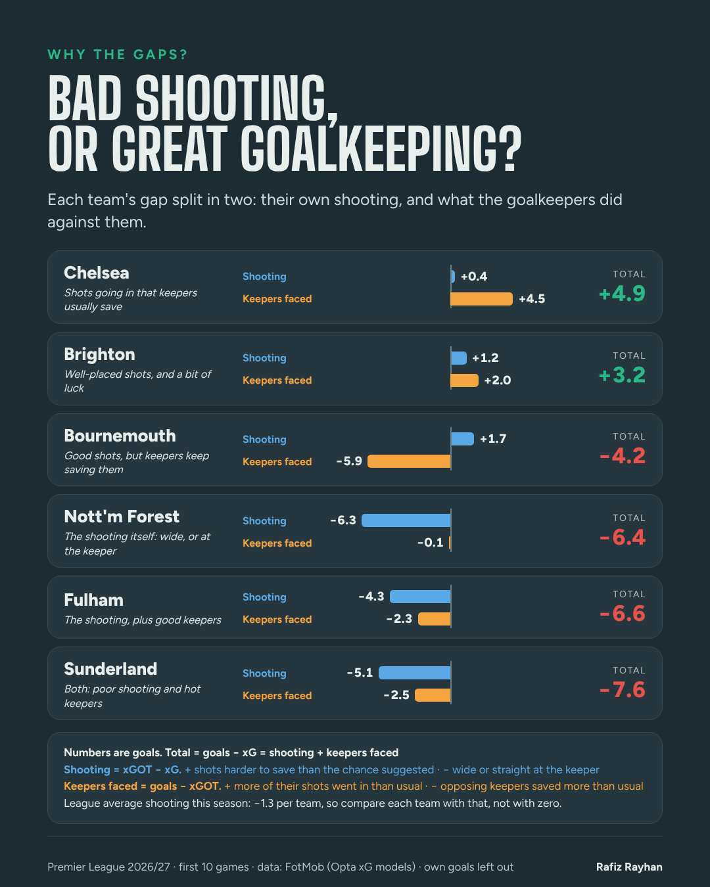

# Premier League 2026/27: bad shooting, or great goalkeeping?

After 10 games, some teams have scored far more or far fewer goals than their chances were worth. This project splits each gap in two: how well the team placed its shots, and what the goalkeepers did against them. It also ranks goalkeepers by goals prevented and players by finishing.

It follows on from [Premier League 2026/27: who is beating their expected points?](https://github.com/rafizrayhan/epl-xpts-2026-27), which found the gaps. This one asks where they come from.



## Question

When a team scores fewer goals than its chances deserve, is it bad shooting, good goalkeeping by the opposition, or both?

## Data

- **Source:** [FotMob](https://www.fotmob.com) match shot maps, with xG and xGOT from Opta's models, and the goalkeeper who faced each shot.
- **Coverage:** matchdays 1 to 10 (21 August to 9 November 2026), 100 matches, 2,733 shots (own goals left out), 854 shots on target, 260 goals.
- **Goalkeepers:** FotMob gives only an ID for the keeper who faced each shot. All 25 IDs were named from their FotMob player pages (`data/keepers.csv`), and every keeper's club matches the team he faced shots for, in every match.

The shot files are not included. `src/s0_download.py` fetches them for personal, non-commercial analysis (the same downloader as the xPts project).

## Three numbers behind every goal

| Number | What it measures |
|---|---|
| **xG** (expected goals) | the chance: how often an average player scores from that spot and situation |
| **xGOT** (expected goals on target) | the shot: re-rates it after it is struck, from where it ends up in the goal. 0 for shots off target or blocked |
| **Goal** | the outcome: did it go in? |

From these:

- **Finishing** = goals − xG
- **Shooting (placement)** = xGOT − xG: were the shots harder or easier to save than the chances suggested?
- **Against keepers** = goals − xGOT: did more or fewer of those shots go in than usual?
- **Goals prevented** (keepers) = xGOT faced − goals conceded

So finishing = shooting + against keepers, for every team.

**Excluded:** own goals (no shooter, no xGOT); blocked shots (not on target); for keepers, the 34 shots cleared off the line by defenders, which are not keeper saves. Player tables leave out penalties; team and keeper tables are also given without penalties in the CSVs.

## Results after 10 games

| Team | Goals | xG | xGOT | Finishing | Shooting | Against keepers |
|---|---|---|---|---|---|---|
| Chelsea | 19 | 14.1 | 14.5 | +4.9 | +0.4 | +4.5 |
| Brighton | 23 | 19.8 | 21.0 | +3.2 | +1.2 | +2.0 |
| Ipswich | 15 | 13.5 | 15.9 | +1.5 | +2.4 | −0.9 |
| Newcastle | 13 | 11.5 | 10.4 | +1.5 | −1.1 | +2.6 |
| Hull | 11 | 9.6 | 9.2 | +1.4 | −0.4 | +1.8 |
| Man City | 21 | 20.1 | 19.0 | +0.9 | −1.1 | +2.0 |
| Coventry | 10 | 9.6 | 10.8 | +0.4 | +1.2 | −0.8 |
| Brentford | 15 | 14.9 | 12.8 | +0.1 | −2.1 | +2.2 |
| Aston Villa | 14 | 13.9 | 10.4 | +0.1 | −3.6 | +3.6 |
| Arsenal | 15 | 16.2 | 15.4 | −1.2 | −0.8 | −0.4 |
| Everton | 12 | 14.0 | 13.6 | −2.0 | −0.4 | −1.6 |
| Liverpool | 13 | 15.8 | 14.2 | −2.8 | −1.7 | −1.2 |
| Spurs | 9 | 12.5 | 12.4 | −3.5 | −0.1 | −3.4 |
| Bournemouth | 14 | 18.2 | 19.9 | −4.2 | +1.7 | −5.9 |
| Leeds | 9 | 13.3 | 12.7 | −4.3 | −0.6 | −3.7 |
| Man Utd | 13 | 18.0 | 14.2 | −5.0 | −3.7 | −1.2 |
| Palace | 9 | 14.2 | 11.9 | −5.2 | −2.3 | −2.9 |
| Nott'm Forest | 9 | 15.4 | 9.1 | −6.4 | −6.3 | −0.1 |
| Fulham | 8 | 14.6 | 10.3 | −6.6 | −4.3 | −2.3 |
| Sunderland | 8 | 15.6 | 10.5 | −7.6 | −5.1 | −2.5 |

(Rounded; parts may differ from the total by 0.1.)

**What it shows**

- **Forest's gap is their shooting.** Almost all of their −6.4 is placement (−6.3); keepers have done nothing unusual against them. The weakness is spread across the squad (Gibbs-White, Murillo, McAtee, Delap).
- **Bournemouth have been unlucky.** Their shots are well placed (+1.7), but keepers have saved about 6 more goals than expected against them, and their own keeper has conceded about 2.8 more than expected. The strongest case in the league for results to turn.
- **Sunderland and Fulham have both problems:** poor placement and good goalkeeping against them. Fulham's placement deficit is mostly one player, Gonzalo García (1 goal from 4.1 xG, 4 of 24 shots on target).
- **Chelsea's extra goals are going in past keepers,** not coming from better-placed shots (+0.4). That is the part least likely to last.
- **Goalkeepers:** Bart Verbruggen (Brighton, +4.4) and Carl Rushworth (Coventry, −5.2) stand out most. Verbruggen explains a large part of Brighton's over-performance in the xPts table.

**League-wide shift.** Across the league, placement totals −26.8 this season (about −1.3 per team): shots have been less well placed than their chances suggested. This is where this season's goals-below-xG shortfall comes from, and why the xPts project scaled xG by 0.882. Compare each team's shooting with −1.3, not with zero. Keepers as a group total +8.0.

## How sure can we be?

Ten games is a small sample. Each keeper's goals prevented comes with a luck range: the standard deviation of goals conceded under xGOT, about ±2 goals for a regular starter. Only Verbruggen (+2.1 SD) and Rushworth (−2.2 SD) are past 2 SD, but with 22 keepers tested, one or two that far out is what chance alone would produce. The same applies to players: Rayan Cherki (+3.1, 2.5 SD) stands out among 53 players with 15+ shots. Treat individual numbers as tendencies; the team-level splits are on firmer ground.

xGOT does not see deflections, screened shots or the keeper's starting position, so a low number for a keeper is not proof of poor goalkeeping.

## Outputs

**Pages for a general audience (1080×1350):**

| | |
|---|---|
| `out/page_0_explainer.png` | Three numbers behind every goal |
| `out/page_1_teams.png` | Who is scoring more than their chances? |
| `out/page_2_why.png` | Bad shooting, or great goalkeeping? |
| `out/page_3_keepers.png` | Which keepers are saving the most? |
| `out/page_4_players.png` | Hottest and coldest finishers |
| `out/page_5_shotmap_1.png` | Shot maps: Chelsea and Brighton (running hot) |
| `out/page_5_shotmap_2.png` | Shot maps: Forest and Bournemouth (same problem, different reason) |
| `out/page_5_shotmap_3.png` | Shot maps: Fulham and Sunderland (wrong in both places) |

**Analyst charts:** `out/chart_teams.png` (all 20 teams split), `out/chart_keepers.png` (22 keepers with luck bands), `out/chart_players.png` (goals v xG for 53 players).

**Tables:** `data/team_finishing.csv`, `data/keepers_prevented.csv`, `data/players_finishing.csv`.

## Run it

```bash
pip install -r requirements.txt
playwright install chromium
python src/s0_download.py        # fetch the shot files into raw/ (skip if you already have them)
python src/s1_shots.py           # shot table with xG, xGOT and keeper; team finishing table + checks
python src/s2_keepers.py         # goalkeeper goals prevented
python src/s3_players.py         # player finishing (non-penalty)
python src/s4_charts.py          # analyst charts
python src/s5_pages.py           # pages for a general audience
python src/s6_shotmaps.py        # shot maps: where teams shoot from and where shots on target end up
```

Run the scripts from the repository root. A clean run in a fresh folder reproduces every table in `data/` exactly.

**Checks in the scripts:** all 100 matches present; every goal is on target and has xGOT; no xGOT on shots off target or blocked; every on-target shot faced by a keeper has a keeper ID, and each keeper's club matches the team that faced the shot; player goals add up to the league's 243 non-penalty goals.

## Limitations

- 10 games: most individual keeper and player numbers are within normal luck.
- xG and xGOT are Opta's models, used as published. Different providers' models would give somewhat different numbers.
- Team "against keepers" mixes goalkeeping and luck; it cannot separate the two.
- Fonts: Figtree and Big Shoulders Display (SIL Open Font License, licences in `fonts/`).

Data: FotMob (xG and xGOT by Opta). Personal, non-commercial analysis. Not affiliated with the Premier League, FotMob or Opta.

Rafiz Rayhan
